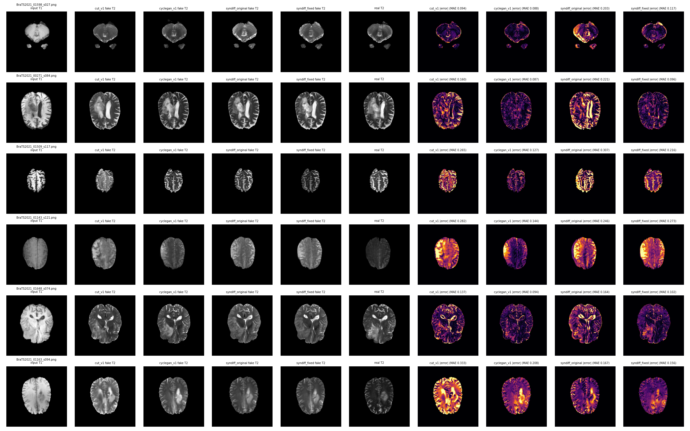

# Unpaired T1 → T2 Brain MRI Translation: CycleGAN vs CUT vs SynDiff

We generate a T2-weighted brain MRI slice from a T1-weighted slice of the same patient, training with
**unpaired** data (no patient's T1 and T2 are both seen in training), and compare three methods under
identical conditions: CycleGAN, CUT, and the adversarial diffusion model SynDiff. All three use the same BraTS 2021
patients, the same patient-level split, the same 200 evaluation slices and the same brain-masked SSIM / PSNR / MAE
script. CycleGAN clearly beats CUT. Out of the box, SynDiff's outputs are shifted by a few whole pixels, which sinks its pixel-wise scores.
Nothing in SynDiff's losses fixes where the anatomy sits, so we add a small structure loss that keeps it in place. With that loss, SynDiff
is the best of the three on brain SSIM (0.543 vs 0.512 for CycleGAN; higher on 17 of 20 test patients,
paired Wilcoxon p = 0.00017).

**Authors:** Aditya Choudhury and Shrinidhi Kulkarni.
CPSC 8810 (ML-based Image Synthesis), Clemson University, Fall 2026.

**Blog post:** <https://aditya684git.github.io/mri-t1-t2-translation/>



---

## Results

Eval subset: 200 axial slices from 20 held-out test patients. Metrics are computed **inside the brain mask only**
(background is trivially correct for every model and would inflate scores). Mean ± std over slices.

| Model | SSIM (brain) | PSNR (brain, dB) | MAE (brain) |
|---|---|---|---|
| Identity baseline (T1 used as T2) | −0.130 | 7.70 | 0.375 |
| CUT | 0.146 ± 0.092 | 13.17 ± 1.84 | 0.171 ± 0.051 |
| CycleGAN | 0.512 ± 0.129 | 15.90 ± 2.71 | 0.129 ± 0.063 |
| SynDiff, original | 0.105 ± 0.049 | 12.04 ± 1.47 | 0.190 ± 0.043 |
| SynDiff, original, outputs re-aligned to the input T1 | 0.507 ± 0.125 | 15.82 ± 2.38 | 0.127 ± 0.053 |
| **SynDiff + silhouette structure loss (ours)** | **0.543 ± 0.134** | **16.15 ± 2.65** | **0.124 ± 0.056** |

**Which SynDiff epoch?** `diffusion_sc_v1` is **epoch 30**, the final epoch, and is the reported result (the same
final-epoch rule as the GANs). `diffusion_sc_v1_e5` is **epoch 5**, the epoch selected on the 5 validation patients
(241 slices, none in the eval subset); it scores 0.566 / 16.43 / 0.121 and is reported as secondary. Neither choice
used eval numbers. CycleGAN and CUT show no shift: re-aligning them to their input changes nothing
(`cyclegan_v1_aligned` and `cut_v1_aligned` in `results/results.csv` equal the unaligned scores).

**Is SynDiff + structure loss really better than CycleGAN?** Per-patient paired comparison on the same 20 test
patients (mean over each patient's 10 slices; two-sided Wilcoxon signed-rank test, exact,
[`scripts/wilcoxon_per_patient.py`](scripts/wilcoxon_per_patient.py)):

| Metric | CycleGAN | SynDiff + structure loss | Patients improved | Wilcoxon W | p |
|---|---|---|---|---|---|
| SSIM (brain) | 0.512 | 0.543 | 17 / 20 | 13 | **0.00017** |
| PSNR (brain, dB) | 15.90 | 16.15 | 12 / 20 | 75 | 0.28 |
| MAE (brain) | 0.129 | 0.124 | 12 / 20 | 76 | 0.29 |

The SSIM gain is consistent across patients. The PSNR and MAE gains are small and not statistically significant, so
on intensity error the two models are about level. 20 patients and one training run per model.

Charts of these results (main results, per-patient comparison, data size, shift heatmaps, generator shifts, loss
sweep, shift drift, close-ups) are in [`figures/slides/`](figures/slides/README.md). `figures/make_slide_figures.py`
regenerates the charts from the files in `results/`, and `figures/make_closeups.py` makes the close-ups (it needs
the model outputs, which are not in this repo).

All runs are in [`results/results.csv`](results/results.csv), with per-slice scores alongside. The analyses behind these
numbers are in [`gan/README.md`](gan/README.md) (CycleGAN vs CUT: contrast polarity, a check that
neither is shifted, intensity) and [`diffusion/README.md`](diffusion/README.md) (SynDiff: the output shift, its cause, the structure
loss, and the validation-only selection rule).

---

## Repository layout

```
.
├── README.md                 this file
├── LICENSE                   MIT, for our own code (third-party licenses below)
├── gan/README.md             CycleGAN and CUT: preprocessing, training, evaluation, findings
├── requirements.txt          Python package versions we used
├── upstream_versions.txt     exact commits of the three upstream model repos
├── split.json                patient split, preprocessing settings, fixed 200-slice eval subset
│
├── check_alignment.py        T1/T2 co-registration check
├── preprocess.py             BraTS NIfTI volumes → unpaired PNG folders (trainA / trainB / testA / testB / testMask)
├── check_preprocess.py       preview grid of preprocessed slices
├── evaluate.py               brain-masked SSIM / PSNR / MAE → results/
├── compare_outputs.py        side-by-side figures with error maps
├── shift_check.py            is an output spatially offset from the real T2?
├── polarity_check.py         does fine detail follow the input T1 or the real T2?
├── intensity_check.py        per-patient brightness of real vs generated T2
│
├── *.sbatch                  Slurm jobs for CycleGAN / CUT (smoke tests, full runs, inference, GPU test)
├── patches/
│   ├── cut_grayscale.patch   our one-line grayscale fix to CUT's data loader
│   └── LICENSE_CUT           CUT's license (the patch contains a few lines of CUT code)
│
├── diffusion/                SynDiff: data conversion, training wrappers, inference, structure loss, tests
│   ├── README.md             full SynDiff notes and commands
│   ├── syndiff_train_sc.py   SynDiff's train.py plus our optional structure loss (added lines tagged # [sc])
│   └── LICENSE_SynDiff       SynDiff's MIT license, which covers syndiff_train_sc.py
│
├── scripts/
│   └── wilcoxon_per_patient.py   per-patient paired Wilcoxon test between two runs
│
├── results/                  results table, per-slice CSVs, SynDiff validation scores
├── figures/                  alignment, preprocessing and model-comparison figures
│   ├── slides/               result charts and close-ups (PNG + SVG), with a README
│   ├── make_slide_figures.py the seven charts, read from results/
│   └── make_closeups.py      close-ups (needs the model outputs)
└── docs/                     the project blog post (GitHub Pages)
```

No MRI data, model checkpoints or upstream model repositories are included.

---

## Getting the data

We use the **BraTS 2021 Task 1** training set (1,251 patients, co-registered and skull-stripped
T1 / T1ce / T2 / FLAIR volumes, 240 × 240 × 155). We use only T1 and T2. The data is **not** redistributed here.
Request it from the official source and accept its terms of use:

- Official: RSNA-ASNR-MICCAI BraTS 2021 Challenge, via Synapse: <https://www.synapse.org/Synapse:syn25829067>
- We obtained the same training set through Kaggle, from the mirror
  <https://www.kaggle.com/datasets/dschettler8845/brats-2021-task1>, using the Kaggle API
  (download command in [`gan/README.md`](gan/README.md#3-data); needs your own Kaggle API credentials).

If you use the data, cite the BraTS papers listed on the challenge page (Baid et al. 2021,
[arXiv:2107.02314](https://arxiv.org/abs/2107.02314); Menze et al. 2015; Bakas et al. 2017).

Then preprocess (the settings are recorded in `split.json`):

```bash
python check_alignment.py --root $DATA_DIR/extracted --n 5 --out figures/alignment_check.png
python preprocess.py      --root $DATA_DIR/extracted --out $DATA_DIR/brats_t1t2 --min_frac 0.4 --workers 10
```

This draws 400 patients (seed 42) and splits them **by patient**: 160 give only T1 (`trainA`), a different 160 give
only T2 (`trainB`), and 80 are held out for testing. The 200-slice eval subset comes from 20 of the test patients.

---

## Reproducing each model (high level)

We ran everything on Clemson's Palmetto 2 cluster (Slurm, V100 / A100 GPUs, Python 3.10, PyTorch with CUDA 12.6).
The scripts assume data under `/scratch/$USER/brats/brats_t1t2` and outputs under `/scratch/$USER/...`. On another
system, edit the `DATA=` / `RUNS=` lines and the `#SBATCH --account` / `--partition` lines in the `.sbatch` files.
Environment setup is in [`gan/README.md`](gan/README.md#1-environment) and `requirements.txt`.

### Upstream code (not included, cloned separately at pinned commits)

| Model | Official repository | Commit we used |
|---|---|---|
| CycleGAN (Zhu et al., ICCV 2017) | <https://github.com/junyanz/pytorch-CycleGAN-and-pix2pix> | see `upstream_versions.txt` |
| CUT (Park et al., ECCV 2020) | <https://github.com/taesungp/contrastive-unpaired-translation> | see `upstream_versions.txt` |
| SynDiff (Özbey, Dalmaz et al., IEEE TMI 2023) | <https://github.com/icon-lab/SynDiff> | see `upstream_versions.txt` |

### CycleGAN

1. Clone the official repo into `~/mri-project/` and check out the pinned commit.
2. `sbatch cyclegan_v1.sbatch`: grayscale 256 × 256, ResNet-9 generator, 60 epochs (30 constant LR + 30 decay), ~20 h on a V100.
3. `sbatch run_test.sbatch cyclegan_v1`, then `python evaluate.py --run cyclegan_v1 --pred_dir <results>/cyclegan_v1/test_latest/images`.

### CUT

1. Clone the official repo into `~/mri-project/`, check out the pinned commit, and apply
   `patches/cut_grayscale.patch` (CUT's loader otherwise always loads RGB and crashes with `--input_nc 1`).
2. `sbatch cut_v1.sbatch`: same budget and settings as CycleGAN.
3. `sbatch run_test.sbatch cut_v1`, then `python evaluate.py --run cut_v1 ...`.

### SynDiff (original and with our structure loss)

1. Clone the official repo into `~/SynDiff` at the pinned commit. It is used **unmodified**.
2. `python diffusion/make_mat.py --data <brats_t1t2> --out <syndiff_data>/n7514` converts our PNGs to SynDiff's `.mat` format.
3. Original model: `sbatch diffusion/syndiff_train.sbatch n7514 <epochs>`.
   With our structure loss: `sbatch diffusion/syndiff_sc_train.sbatch n7514 30 silhouette 0.5`.
4. Choose the epoch on **validation patients only** (`diffusion/syndiff_val.sbatch` + `diffusion/score_val.py --select`).
5. `sbatch diffusion/syndiff_infer.sbatch <exp> <epoch> n7514 <run name>` generates the 200 eval slices and runs `evaluate.py`.

Step-by-step commands, the EMA / PyTorch-compatibility wrapper, and SynDiff quirks are in
[`diffusion/README.md`](diffusion/README.md). Laptop-runnable checks (no GPU) are `diffusion/test_*.py`.

---

## License

Our own code is released under the [MIT License](LICENSE). The third-party files below keep their original licenses.

## Third-party code and licenses

- `diffusion/syndiff_train_sc.py` is a copy of SynDiff's `train.py` (© 2022 ICON Lab, MIT License) with added lines
  tagged `# [sc]`; see [`diffusion/LICENSE_SynDiff`](diffusion/LICENSE_SynDiff).
- `patches/cut_grayscale.patch` contains a few lines of context from CUT (© 2020 Taesung Park and Jun-Yan Zhu,
  BSD-style license); see [`patches/LICENSE_CUT`](patches/LICENSE_CUT).
- No other upstream code is included. CycleGAN, CUT and SynDiff are cloned from their official repositories, linked above.
